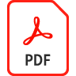

# Personalize e marque um modelo 3D com [!DNL Dimension] e Adobe [!DNL Stock]

Personalize e marque um modelo 3D no [!DNL Dimension] usando materiais, propriedades ambientais, iluminação e fotografia para criar imagens realistas para qualquer projeto de design.

>[!VIDEO](https://video.tv.adobe.com/v/331005?hidetitle=true)

Clique no ícone de PDF para baixar um Guia de referência rápida deste tutorial.

