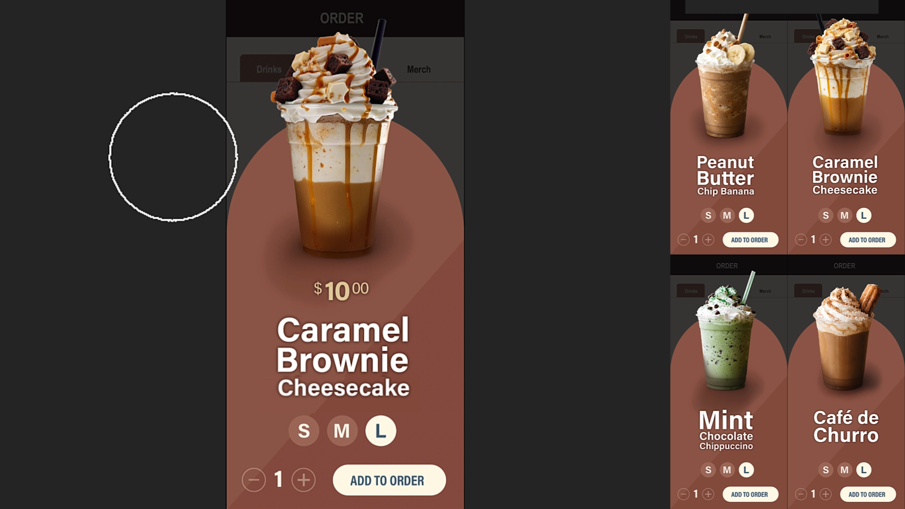

# Tutoriais do Creative Cloud para IA corporativa

Explore tutoriais que podem ajudar você a descobrir ideias, criar conteúdo e otimizar fluxos de trabalho criativos usando IA no Creative Cloud. Estes tutoriais são agrupados por função: Designer gráfico, Director criativo/artístico, Artista/Retoucher do Photoshop e Editor de vídeo.

## Designer gráfico

<table style="table-layout:fixed">
<tr>
 <td>
   
    

   <a href="turn-flat-vector-art.md"><strong>Transforme uma arte vetorial plana em qualquer ângulo, sem redesenhá-la</strong></a>
    

    <em>Saiba como usar Texto como Padrão no Illustrator</em>
     
  </td>
  <td>
   
    

   <a href="seamless-vector.md"><strong>Padrões vetoriais perfeitos em minutos, não em horas</strong></a>
    

    <em>Saiba como criar um padrão de marca perfeito no Illustrator sem verificar cada repetição manual</em>
     
  </td>
  <td>
    
    

     
  </td>
  <td>
    
    

     
  </td>
</tr>
</table>

## Director criativo/artístico

<table style="table-layout:fixed">
<tr>
  <td>
   
    

   <a href="one-brief.md"><strong>20 direções de um resumo, antes do almoço</strong></a>
    

    <em>Saiba como transformar um resumo criativo em uma tabela compartilhada de fortes direções visuais</em>
     
  </td>
  <td>
   
    

   <a href="brief-to-storyboard.md"><strong>Do resumo ao storyboard: explore as direções do vídeo antes da produção</strong></a>
    

    <em>Saiba como transformar um resumo criativo em uma tabela compartilhada de fortes direções visuais</em>
     
  </td>
  <td>
    
    

     
  </td>
  <td>
    
    

     
  </td>
</tr>
</table>

## Artista/Retoucher da Photoshop

<table style="table-layout:fixed">
<tr>
  <td>
   
    

   <a href="retouch-faster.md"><strong>Retoque mais rápido e mantenha seus pixels originais</strong></a>
    

    <em>Saiba como adicionar sombras naturais a uma foto de produto no Photoshop enquanto mantém os pixels originais intactos</em>
     
  </td>
  <td>
   
    

   <a href="build-presets.md"><strong>Crie predefinições para uniformizar as cores em uma foto</strong></a>
    

    <em>Saiba como dar a uma sessão de fotos inteira uma aparência consistente sem editar cada imagem uma a uma</em>
     
  </td>
  <td>
    
    

     
  </td>
  <td>
    
    

     
  </td>
</tr>
</table>

## Editor de vídeo

<table style="table-layout:fixed">
<tr>
  <td>
   
    

   <a href="fill-gaps.md"><strong>Preencha lacunas no corte: rolagem B, áudio e clipes que terminam muito cedo</strong></a>
    

    <em>Saiba como usar a Extensão Generativa no Premiere</em>
     
  </td>
 <td>
   
    

   <a href="rough-cut.m"><strong>Acesse o copião mais rápido</strong></a>
    

    <em>Saiba como criar um copião a partir de entrevistas e rolar o filme mais rápido no Premiere, sem arrastar cada clipe</em>
     
  </td>
  <td>
    
    

     
  </td>
  <td>
    
    

     
  </td>
</tr>
</table>

