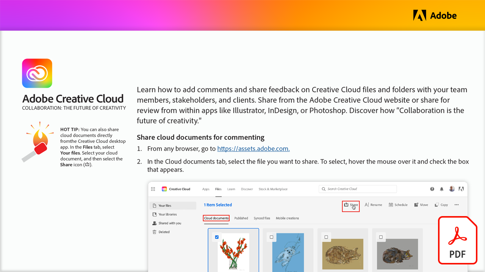

# Colaboração: o futuro da criatividade

Aprenda a adicionar comentários e compartilhar feedback sobre arquivos e pastas da Creative Cloud com membros da equipe, partes interessadas e clientes. Compartilhe pelo site da Adobe Creative Cloud ou compartilhe para revisão em aplicativos como Illustrator, InDesign ou Photoshop.

Selecione a imagem abaixo para ver ou baixar este tutorial do PDF.

[{width="680"}](assets/Collaboration-The-Future-of-Creativity.pdf){target="blank"}
