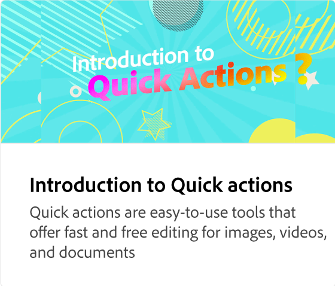

# O que há na Página Inicial

Explore a página inicial para poder navegar facilmente pelo aplicativo. Saiba mais sobre ações rápidas, modelos, designs sazonais, marcas, bibliotecas, agendador, tutoriais e muito mais.

>[!VIDEO](https://video.tv.adobe.com/v/3426924?quality=12&learn=on&hidetitle=true)

## Vídeos adicionais desta série

<table style="table-layout:fixed">
<tr>
    <td>
      
    </td>
    <td>
      
    </td>
    <td>
      
      

       
    </td>
   <td>
      
      

       
   </td>
</tr>
</table>
