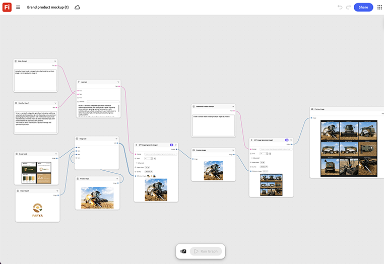

# Modelo de produto da marca

Saiba como visualizar seu produto em cenas de diferença. Solte uma renderização de produto ou foto no nó do modelo. O gráfico o coloca dentro de uma cena totalmente marcada, com iluminação e sombra correspondentes a essa cena automaticamente. [Abrir modelo de produto de marca](https://firefly.adobe.com/graph/edit/id/urn:aaid:sc:US:18717173-ecd7-5f76-8788-6be6cb977d93).

[!BADGE Exemplos do setor]{type=Informative tooltip="Exemplos do setor"}

* **Varejo** - Simule uma nova linha de produtos sazonais dentro de uma cena de exibição de marca na loja, antes que a exibição física exista.
* **Bebidas** - Visualize um novo design de garrafa dentro de uma cena com refrigerador de varejo totalmente da marca antes da produção.
* **Tecnologia** - Simule um novo dispositivo dentro de uma cena de prateleira de varejo para uma plataforma de lançamento.

>[!TIP]
>
>**Antes de começar** - Para obter os melhores resultados, personalize este modelo de acordo com sua própria marca, produto e fluxo de trabalho. Troque suas imagens de referência, prompts e copie antes de usar qualquer saída.

{align="center"}

Retorne ao [Introdução ao Firefly Graph](https://experienceleague.adobe.com/en/docs/creative-cloud-enterprise-learn/cce-learning-hub/fireflyoverview/firefly-graph/overview-firefly-graph).
