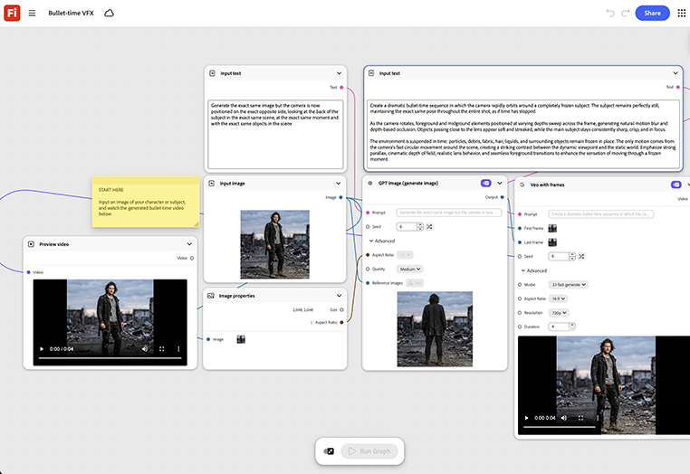

# Tempo de Marcador VFX

Aprenda a alimentar um produto ou imagem do objeto principal para gerar uma sequência giratória de ângulos ao redor e costurar a varredura de quadro congelada automaticamente. [Abrir modelo VFX de Marcador de Tempo](https://firefly.adobe.com/graph/edit/id/urn:aaid:sc:US:3efb4f51-345d-58eb-b7c8-7b289f0dd1c4).

[!BADGE Exemplos do setor]{type=Informative tooltip="Exemplos do setor"}

* **Atividades ao ar livre** - Crie uma foto de herói à bala de um alpinista em movimento para um anúncio para redes sociais pago, sem um equipamento multicâmera no local.
* **Varejo** - Crie uma foto de quadro congelado em 360 graus de um novo tênis para uma página de lançamento de produto.
* **Automotivo** - Gere uma foto de herói girando de um veículo para um showroom digital, sem uma sessão de estúdio de plataforma giratória.

>[!TIP]
>
>**Antes de começar** - Para obter os melhores resultados, personalize este modelo de acordo com sua própria marca, produto e fluxo de trabalho. Troque suas imagens de referência, prompts e copie antes de usar qualquer saída.

{align="center"} de Marcador

Retorne ao [Introdução ao Firefly Graph](https://experienceleague.adobe.com/pt-br/docs/creative-cloud-enterprise-learn/cce-learning-hub/fireflyoverview/firefly-graph/overview-firefly-graph).
