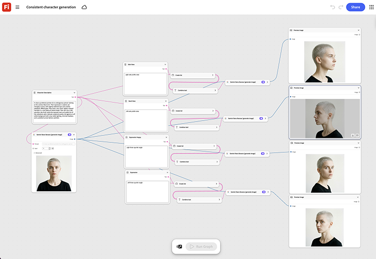

# Geração consistente de caracteres

Saiba como carregar uma imagem de referência do personagem e, em seguida, trocar a cena ou o prompt de pose para cada nova tomada. [Abrir modelo de geração de caracteres consistente](https://firefly.adobe.com/graph/edit/id/urn:aaid:sc:US:6ab4c3c7-ead2-5fa5-9441-75b7a362ce11).

[!BADGE Exemplos do setor]{type=Informative tooltip="Exemplos do setor"}

* **Viagem** - Mantenha um personagem de guia ou mascote recorrente consistente em uma série de destino de vários vídeos e conteúdo para redes sociais, sem precisar informar novamente um ilustrador para cada cena.
* **Varejo** - mantenha um personagem de marca em dezenas de fotos de produtos sazonais e publicações em redes sociais.
* **Instituições de ensino** - mantenha um personagem instrutor animado consistente em todos os vídeos de aula de um curso.

>[!TIP]
>
>**Antes de começar** - Para obter os melhores resultados, personalize este modelo de acordo com sua própria marca, produto e fluxo de trabalho. Troque suas imagens de referência, prompts e copie antes de usar qualquer saída.

{align="center"}

Retorne ao [Introdução ao Firefly Graph](https://experienceleague.adobe.com/en/docs/creative-cloud-enterprise-learn/cce-learning-hub/fireflyoverview/firefly-graph/overview-firefly-graph).
