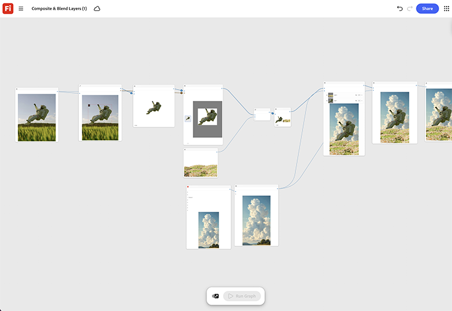

# Composição e mesclagem de camadas

Saiba como empilhar um recorte de produto e uma cena de plano de fundo como entradas de camada separadas. Ajuste o modo de mesclagem e os nós de iluminação até que a composição seja lida como uma tomada. [Abrir modelo de camadas compostas e de mesclagem](https://firefly.adobe.com/graph/edit/id/urn:aaid:sc:US:6ab4c3c7-ead2-5fa5-9441-75b7a362ce11).

[!BADGE Exemplos do setor]{type=Informative tooltip="Exemplos do setor"}

* **Bebidas** - Compor uma nova lata de design em uma cena de estilo de vida de praia para uma campanha de verão, sem voar em uma
grupo de fotos para um local.
* **Varejo** - Combinar um recorte de produto em um plano de fundo de estilo de vida sazonal para um banner de página inicial.
* **Viagem** - Componha um plano de fundo de destino atrás de uma foto de produto para uma promoção de marca conjunta.

>[!TIP]
>
>**Antes de começar** - Para obter os melhores resultados, personalize este modelo de acordo com sua própria marca, produto e fluxo de trabalho. Troque suas imagens de referência, prompts e copie antes de usar qualquer saída.

{align="center"}

Retorne ao [Introdução ao Firefly Graph](https://experienceleague.adobe.com/pt-br/docs/creative-cloud-enterprise-learn/cce-learning-hub/fireflyoverview/firefly-graph/overview-firefly-graph).
