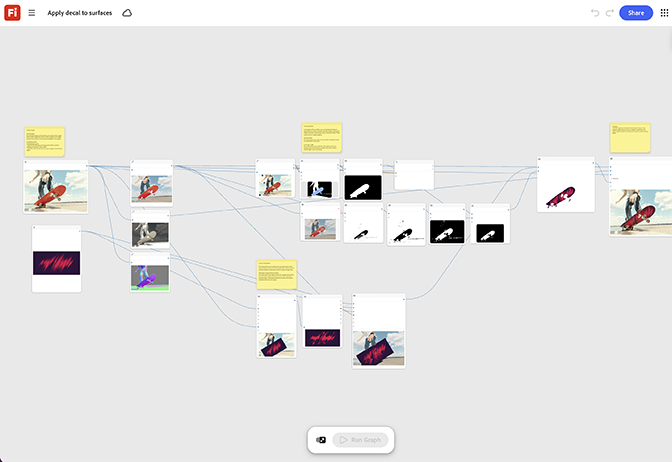

# Aplicar decalque nas superfícies

Saiba como visualizar decalques ou logotipos em modelos de produtos. O modelo quebra o decalque na geometria da superfície para que siga os contornos corretamente. [Abra Aplicar decalque ao modelo de superfícies](https://firefly.adobe.com/graph/edit/id/urn:aaid:sc:US:78443d67-3663-50df-868e-dd231469f868).

[!BADGE Exemplos do setor]{type=Informative tooltip="Exemplos do setor"}

* **Atividades ao ar livre** - aplique um decalque de logotipo atualizado em uma linha completa de modelos de engrenagens para visualizar uma nova identidade visual antes de as ferramentas de produção serem solicitadas.
* **Automotivo** - visualize um novo design de biblioteca ou decalque em um modelo de veículo antes de embalar a produção.
* **Varejo** - Teste um novo posicionamento de logotipo em uma linha de modelo de vestuário completa antes de aprovar a impressão.

>[!TIP]
>
>**Antes de começar** - Para obter os melhores resultados, personalize este modelo de acordo com sua própria marca, produto e fluxo de trabalho. Troque suas imagens de referência, prompts e copie antes de usar qualquer saída.

{align="center"}

Retorne ao [Introdução ao Firefly Graph](https://experienceleague.adobe.com/en/docs/creative-cloud-enterprise-learn/cce-learning-hub/fireflyoverview/firefly-graph/overview-firefly-graph).
