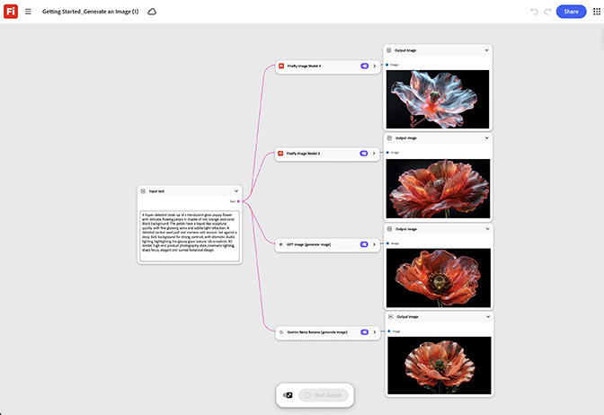

# Introdução - Gerar uma imagem

Saiba como criar um gráfico básico: um nó de prompt em um nó de geração em uma saída. [Abra o Guia de Introdução - Gere um modelo de imagem](https://firefly.adobe.com/graph/edit/id/urn:aaid:sc:VA6C2:f556b557-d31b-4659-b9d1-358ed567c61d).

[!BADGE Exemplos do setor]{type=Informative tooltip=""}

* **Varejo** - Gere uma primeira imagem de herói do produto usando um resumo para aprender o fluxo de nó básico antes de tocar em um ativo real da campanha.
* **Integridade** - Teste o fluxo de geração de imagem mais simples em uma captura de produto de espaço reservado antes de dimensionar para um calendário de conteúdo completo.
* **Instituições de ensino** - Crie uma primeira imagem de amostra para demonstrar o gráfico aos novos membros da equipe antes de atribuir um trabalho de projeto real.

>[!TIP]
>
>**Antes de começar** - Para obter os melhores resultados, personalize este modelo de acordo com sua própria marca, produto e fluxo de trabalho. Troque suas imagens de referência, prompts e copie antes de usar qualquer saída.

{align="center"}

Retorne ao [Introdução ao Firefly Graph](https://experienceleague.adobe.com/en/docs/creative-cloud-enterprise-learn/cce-learning-hub/fireflyoverview/firefly-graph/overview-firefly-graph).
