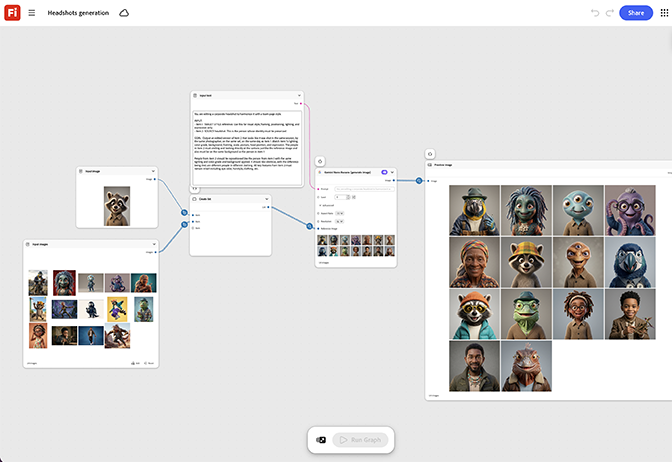

# Geração de headshots

Saiba como harmonizar um lote de fotos principais de empresas. O gráfico normaliza a iluminação, o fundo,
e cortar todo o conjunto em uma execução. [Abrir modelo de geração de Headshots](https://firefly.adobe.com/graph/edit/id/urn:aaid:sc:US:5da3f95f-63e5-5335-9e10-58cfadd7ad3f).

[!BADGE Exemplos do setor]{type=Informative tooltip="Exemplos do setor"}

* **Tecnologia** - Gere um headshot consistente definido para um diretório de funcionários atualizado antes de todas as mãos, sem agendar um fotógrafo para cada nova contratação.
* **Finanças** - Normalizar headshots sobre uma equipe de conselheiros para uma página de encontro com a equipe.
* **Saúde** - Padronize os headshots da equipe em vários locais da clínica para obter uma aparência de site unificada.

>[!TIP]
>
>**Antes de começar** - Para obter os melhores resultados, personalize este modelo de acordo com sua própria marca, produto e fluxo de trabalho. Troque suas imagens de referência, prompts e copie antes de usar qualquer saída.

{align="center"}

Retorne ao [Introdução ao Firefly Graph](https://experienceleague.adobe.com/en/docs/creative-cloud-enterprise-learn/cce-learning-hub/fireflyoverview/firefly-graph/overview-firefly-graph).
